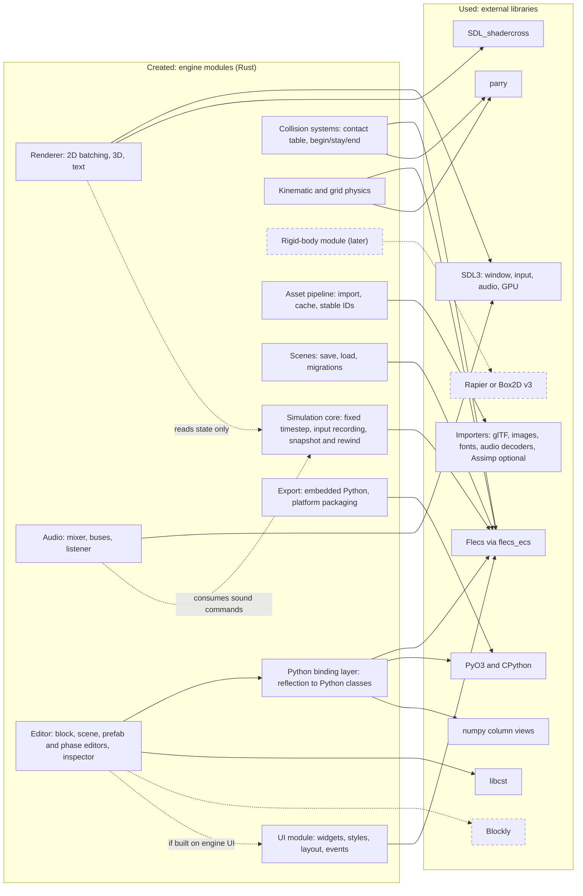
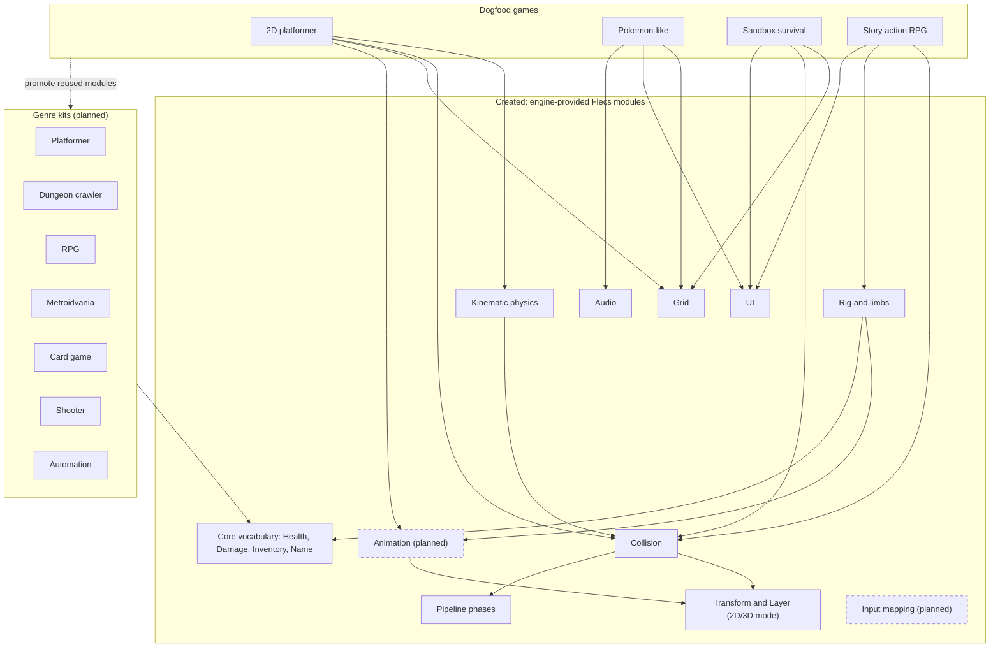

# Morgan's Super Awesome Game Engine: Design Doc (working draft)

Last updated: 2026-11-11 (revision 8) · Status: Milestone 0 implemented, A1 to A4 pass (`docs/milestone-0.md`); Python–Flecs binding implemented (`crates/sage_ecs_py`)
Tags used below: **[Decided]** settled in discussion · **[Leaning]** preferred but not final · **[Open]** unresolved

**Changes in revision 8 (2026-11-11, UI parity plan):** Records Morgan's decision to build the editor on the engine's own ECS UI (10.6, was [Open]), the goal of recreating the HTML features games need with Godot's UI as a second reference, and six decisions that shape the plan (new 9.5). The plan is `docs/ui-html-parity.md`. Design only; no code changed.
**Changes in revision 7 (2026-11-11, UI follow-ups and the playground):** Morgan asked for the UI's listed limits to be closed and for a UI playground. Notes in 5.2 (style inheritance verified for UI components), 9.1 (scrolling, modal focus trap), 9.2 (style groups inherited, text style split from content) and 10.7 (mouse for UI windows). Adds `examples/ui_playground` and the `sage_platform::ui_window` module. No [Decided] item changed.
**Changes in revision 6 (2026-11-11, Milestone 2):** Records the M2 implementation (13.3, `docs/milestone-2.md`): scenes, save games and migrations as three new text formats with per-component schema versions (10.4), and the UI module (9.1, 9.2). Records Morgan's decision on the `Parent` question for UI: `ChildOf` with siblings in StableId order (9.1). Notes that scenes store full values, not prefab override diffs (10.4). Adds glossary rows for save game and interned string. 13.2 records that M2 started while Milestone 0 is open, at Morgan's request.
**Changes in revision 5 (2026-11-11, standalone binding):** Records Morgan's decisions for splitting the Python–Flecs binding into a standalone library (new 3.5): a declarative `Module` class, the `world` global stays Sage-only, and the standalone core does not require StableId. Adds a [Decided] item to 5.4 (`add`, `remove` and `has` take several arguments, and tuples for pairs) and glossary rows for `Module` and the standalone core. Design only: only the 5.4 change is implemented, and the rest is a plan.
**Changes in revision 4 (2026-11-09, Python–Flecs binding):** Morgan asked for complete games written in Python on Flecs. Records Morgan's decisions on Python component storage (3.1) and on the `@system` decorator family (5.4); the [Decided] item in 5.4 changes. Adds a [Leaning] item on the iteration order of Python systems (3.3), a new [Open] item on hashing opaque components (3.3), binding findings at the pin (3.4), and glossary entries for views and opaque components. 13.2 and 13.5 record that this work proceeded while Milestone 0 is open, with Morgan's authorization. Code: `crates/sage_ecs_py` (binding) and `examples/pong` (Pong with every rule in Python).
**Changes in revision 3 (2026-11-09, Milestone 0 implementation):** records the results of spikes S1–S5 and S8 (3.1, 3.4, 9.1, 13.4), with dated notes. Write-ups are in `docs/spikes/`. No [Decided] item changed. One [Open] item is answered by evidence (the `OrderedChildren` fallback, 3.4). The `Parent` question in 9.1 stays [Open] with new facts.
**Changes in revision 2 (handoff preparation):** adds "How to use this document" (below), resolves the module-disable/observer question (5.5), records the `OrderedChildren` exposure question and the Rust-binding risks (3.4, 9.1), replaces the exercise list with Milestone 0, non-goals, a roadmap sketch, Phase 0 spikes and other engineering tasks (13), adds a glossary (14), decisions outside the code including naming (15), and module-map diagrams (Appendix B). The 14 design exercises moved to a separate document (`claude/design-exercises.md`) and keep their numbers.
**Changes in revision 1 (2026-11-09):** added the technology stack, the Godot analysis and determinism (3.1–3.3), block palette and availability (4.7), pipeline phases (5.5), physics, collisions and determinism (8), UI in the ECS (9), platform and tooling scope (10) and the dogfooding plan (11).

---

## How to use this document

- **Audience:** Morgan (design owner) and Claude Code (implementation). Sections 1–12 record what was decided and why. Section 13 says what to build first. Section 14 defines terms.
- **Tags matter.** Build against **[Decided]** items. Treat **[Leaning]** as the default but verify it. Do **not** silently resolve an **[Open]** item: propose an answer, record it in this document (change the tag and add a dated note), then build.
- **Technical claims are hypotheses until verified** against primary documentation or source at the pinned versions. Several came from search summaries or secondary sources (marked "verify", "as understood" or "as far as found"). The Phase 0 spikes in 13.4 exist to settle the highest-risk ones.
- **"Exercise N"** refers to the design exercises in `claude/design-exercises.md`. They are design homework for Morgan, not engineering tasks. Do not attempt them. Engineering tasks are in 13.4 and 13.5.
- **Naming:** the engine's name is undecided (15). Use a single codename constant in code, never the placeholder title.
- **Source of truth:** once the repo exists, `docs/design.md` in the repo is the source of truth and this Project copy is a mirror.

## 1. Vision

An engine for rapid prototyping and exploring game ideas: **low skill floor, high skill ceiling**. A creator (even a child) can implement a game feature in a few blocks, and the same engine can grow into a complete, AAA-scale game without a rewrite.

- A sandbox where ideas can be iterated and expanded quickly.
- An expansive library of premade assets and code ("genre kits") modeled on popular genres: platformers, dungeon crawlers, RPGs, metroidvanias, card games, shooters, automation games.
- Prior art studied: Scratch, Snap!, Kaplay, Dreams, Mario Maker, Game Builder Garage, MakeCode, Unreal Blueprints.
- The failure pattern to avoid: beginner tools have a **cliff** (you hit a wall and must start over in a "real" tool). The goal is a **ramp**.

## 2. Guiding principles

1. **A game is a small database that changes over time.** Entities are rows, components are columns/tables, systems are queries plus actions.
2. **One data model, many zoom levels.** A rule is a sentence, a block, and a line of Python, all losslessly convertible.
3. **Defaults that work, all overridable.** Convention is the on-ramp and nothing is hidden.
4. **The engine is built from its own public parts.** A beginner's `Bouncy` is made from the same primitives a pro uses, so there is no wall.
5. **Always live, always undoable.** State is data, so edit-while-running, rewind and diff are cheap.
6. **A "Why?" button.** Click something that didn't work and the engine explains which rule didn't fire and why (like `EXPLAIN` for game logic).
7. **Hard things become declarations** where honest (e.g. "this thing is Networked"), with the leaks documented.
8. **Plain Python.** No custom macro system. Users should focus on the logic of ordinary Python.
9. **Own the deterministic simulation; keep presentation behind a narrow interface.** **[Leaning]** World state, rules and physics-as-queries form a headless simulation that is reproducible from its inputs. Rendering, audio and windowing consume simulation state and never feed back into it. This keeps rewind, replays and tests cheap (see 3.2, 3.3).

## 3. Core engine: Flecs

**[Decided]** Build on Flecs (C ECS). Our terms map directly: thing = entity, property = component, relation and event are native, rules and phases are part of Flecs systems and pipelines. The contribution of this project is the layers above Flecs: the authoring experience, the shared kit schema and the debugging tools.

Flecs also provides: prefabs, modules, a query language, a web explorer for inspecting entities and running queries, and emscripten/browser support.

### 3.1 Technology stack
- **[Decided]** Rust for the engine base. Flecs through its Rust bindings (the `flecs_ecs` crate; which exact crate and version is settled by spike S1). *Update 2026-11-09 (S1):* `flecs_ecs =0.2.2`, bundling Flecs C 4.1.2; Rust pinned to 1.99.1 because the crate needs edition 2024. PyO3 `=0.30.1` on CPython 3.12, SDL3 via `sdl3 =0.22.1` (SDL 3.4.20, static), parry2d `=0.31.1` (`docs/dependencies.md`). PyO3 for Python scripting. SDL3 for windowing, input, audio and graphics.
- **[Decided]** Physics for early versions: our own collision and kinematic systems built on parry, not a full rigid-body engine (section 8).
- **[Decided, 2026-11-09, Morgan]** Python component access: Flecs reflection data describes each component's fields, and from it we generate Python component classes. For hot loops, expose component columns as array views (numpy-style) instead of per-entity attribute access (a later `@fast_system`, 5.4). *Note 2026-11-09:* implemented for native components (`world.component_type("path")` builds a class from a `#[flecs(meta)]` component). *Note 2026-11-10 (Morgan's decision):* native components whose Flecs path is under `sage` are also importable by that path while a script loads (`from sage.collision import Position`, `from sage import Input`), so editors can treat them as types. Classes still belong to one world: the shared Python module resolves each name for the world that is loading a script, so the import works at a script's top level, not inside a system body. A component cannot shadow an engine name (`sage.World`) or live under a non-native module (`sage.ecs`). Editor stubs are generated from the same reflection data (`Ecs::type_stubs`) into `python/sage/`, and `examples/pong/tests/stubs.rs` fails when they are stale. `world.component_type` stays for paths outside `sage`.
- **[Decided, 2026-11-09, Morgan]** Python-defined components: an `@component` class with annotated fields (`x: sage.f32 = 0.0`; `float` means f64, `int` means i64, plus `bool`, `Entity` and explicit `sage.f32/i32/u32/u64/u8`) is registered as a **reflected Flecs struct**. The Python object is either a value that owns its bytes or a **view** onto the stored bytes, so Python-defined and native components share one mechanism and get hashing, snapshots, JSON and future column views for free. A class without fields is a tag. Single inheritance: a subclass appends fields (the base's fields are a layout prefix) and is registered with `(IsA, Base)`, with `Inheritable` on the base, so a query for the base also matches the subclass. `@component(opaque=True)` stores a pointer to an arbitrary Python object instead, deep-copied on copy. Opaque components are not reflected, hashed or snapshotted (see 3.3). *Note:* Morgan first proposed storing a pointer to the Python instance for every component; the pointer form became the opt-in after the costs were laid out (hash, rewind, prefab copies sharing one object, JSON, palette and column views). Arrays and nested struct fields are not supported yet.
- **Python and threads:** the GIL means Python systems effectively run on one thread. Heavy kit systems should be native; Python is the glue. Free-threaded Python is an option to evaluate later.
- **Graphics:** SDL's GPU API is a low-level API in the style of Metal, Vulkan and Direct3D 12 and takes only compiled shaders. We therefore write the renderer ourselves (materials, lighting, culling, sprite batching, text) and ship a shader toolchain (SDL_shadercross translates HLSL or SPIR-V to each backend's format). **[Open]** renderer scope beyond sprites is probably the largest single work item (10.7).
  - *Update 2026-11-10 (Milestone 1, Morgan):* M1's renderer scope is **[Decided]**: sprite batching, an orthographic camera with a pixel-perfect mode, and bitmap-font text, on the SDL GPU API. Materials, lighting, shadows, culling and shaped text are not built. The sprite shaders are two small SPIR-V modules assembled by `tools/shaderc`, not compiled from source, because SDL's Vulkan backend binds fragment samplers as combined image samplers (`SDL_gpu_vulkan.c`) and the pure-Rust compiler we looked at (naga) emits separate image and sampler objects. Only SPIR-V is produced, so only SDL's Vulkan backend runs; D3D12 and Metal need DXIL and MSL output (SDL_shadercross or more hand work) and are **[Open]**. A machine without Vulkan falls back to the Render API. See `docs/milestone-1.md`.

### 3.2 Why not build on an existing engine (Godot)?
- **[Decided]** Build our own core. The main reasons: Godot has no official Python support and community bindings are immature; GDExtension compatibility depends on engine minor versions; and our central bet (the game as a database with rewind, "Why?" and always-live editing) breaks when a host engine keeps state outside our world.
- Embedding Flecs inside Godot is possible, but then we would own the hard part while inheriting the host's constraints.
- **The test is how narrow the interface to a host is.** If everything the simulation needs from presentation fits a small host interface, presentation can be swapped or borrowed. **[Leaning]** keep such a simulation-to-presentation interface (exercise 13), even though presentation is currently built on SDL3.

### 3.3 Determinism and game loop
- **[Leaning]** Fixed-timestep simulation with render interpolation. Input is data (recorded per tick), so a run can be replayed and a bug reproduced.
- Anything that feeds physics or collision must arrive in a canonical order (for example sorted by stable ID), because Flecs iteration order changes as entities move between archetypes.
- Python hazard: string-set iteration order is randomized per process unless `PYTHONHASHSEED` is fixed, so simulation-affecting scripts must not depend on set order.
- Float determinism holds within one binary and platform by default. Cross-platform determinism needs extra work (8.1).
- **[Open]** Threading model: simulation thread, render thread, audio thread, and how Python systems fit.
- **[Leaning, 2026-11-09]** Python systems carry an implicit first term, `sage.StableId`, and are ordered by it (Flecs `order_by`), so per-entity calls happen in StableId order. Flecs's table order differs after a snapshot is restored into a fresh world, and a system that draws from the RNG per entity would then diverge. Cost: Python systems only see entities that have a StableId (entities created through the binding always do; native code can call `Ecs::assign_sid`). In the block editor this is a visible, locked implicit row, like the prefab `IsA` term (5.4). Observers are not ordered, since an event is one row. *Note 2026-11-11 (Morgan):* this is a Sage policy, not a property of the binding. The standalone core does not require `sage.StableId` (3.5); the Sage adapter keeps the requirement and the ordering.
- **[Open, 2026-11-09]** How to hash and snapshot opaque (Python object) components. They are currently skipped, and `Ecs::has_opaque_state` reports when a simulation entity holds one, so a game that needs determinism can assert it does not. Options: require a `__sage_state__` method returning plain data, or forbid opaque components on simulation entities.
- Simulation state must live in components. The binding hashes and snapshots everything it knows: entities with a StableId, their reflected components, tags and relationships (entity references are stored as StableIds), singletons, the enabled state of flecs modules, the StableId counter and the world RNG. Python module globals are not covered.

### 3.4 Risks
- The only Python binding found on PyPI (`flecs` 0.0.2, pybind11) is a minimal prototype focused on arbitrary Python types rather than performance; the main Flecs README says bindings are community-maintained and may lag. We will likely own the binding. (With the Rust stack, that is our PyO3 layer over `flecs_ecs`.)
- Per-entity Python callbacks cross the FFI boundary and lose Flecs's columnar speed (the pandas row-loop vs set-based problem). **[Leaning]** ramp: beginner Python, then vectorized systems over component columns (numpy-style), then native systems over the same component data. *Measured 2026-11-09 (`crates/sage_ecs_py/tests/cost.rs`, release, Windows):* a per-entity Python system (`pos += vel * dt` on two f32 fields) costs about 1.0 µs per entity: 1.0 ms at 1k entities and 10.1 ms at 10k, against S4's 0.34 and 3.97 ms for a bare call over Rust `Vec`s. The extra cost is view objects and the validity checks on field access. A first version that allocated new views per row cost 3 µs per entity; views are now reused across rows when the callback keeps no reference to them.
- *Binding findings at the pin (2026-11-09, `crates/sage_ecs_py/tests/flecs_assumptions.rs`):* runtime structs built with `ecs_struct_init` get C layout; the query DSL resolves names relative to the scope and handles `up ChildOf`, `?` and `!`; `order_by` works on a runtime component. With an `Inheritable` base, a query for `Base` matches `Derived` and `ecs_field_id` reports `Derived`, but **`ecs_field_size` reports the term's size (Base's), not the column's**, so the row stride must come from the matched id's type info. Emitting an event with an empty id list reaches only `_` (Any) observers. The binding emits with the entity's ids, and de-duplicates the repeat calls an Any observer then gets. Setting `EcsQueryMatchPrefab | EcsQueryMatchDisabled` in a query descriptor's `flags` did not include prefabs or disabled entities; optional `Prefab` and `Disabled` terms do.
- Flecs's newer features (non-fragmenting `Parent`, `OrderedChildren`, `DontFragment`) are young and have had recent fixes. **Pin the Flecs version** and add targeted tests (see 9.1).
- **Rust bindings maturity:** two Flecs crates exist for Rust, an older `flecs` (0.1.x) and `flecs_ecs` (0.2.x, pre-1.0; release 0.2.1 was yanked). `flecs_ecs` adds runtime checks by default to preserve Rust's borrowing and concurrency guarantees, which may cost performance. It is **unconfirmed** whether it exposes `Parent`, `OrderedChildren` or `DontFragment`, or which C Flecs version it bundles (spike S1). *Update 2026-11-09 (S1):* 0.2.2 bundles Flecs C **4.1.2**. `OrderedChildren` and `DontFragment` are wrapped and tested. **`Parent` does not exist in C 4.1.2**, so it is unavailable at this pin (see 9.1). A reduced feature set fails to compile, so default features are used. The runtime safety checks (`flecs_safety_locks`) are on and their cost has not been measured.
- **`OrderedChildren` fallback [Decided, 2026-11-09, S1]:** the hypothesis holds. `flecs::core::OrderedChildren` resolves by name lookup, adding it by id works, and it is the same entity as the wrapped `flecs::OrderedChildren`. Moot at this pin, since the trait is wrapped anyway; kept as a regression test. Original note: Morgan's hypothesis, unverified, is that the trait can be added through a name lookup of the built-in entity and the generic add-by-id API even if the bindings don't wrap it. If that fails, Morgan is willing to fork and extend the bindings.
- Mobile export of embedded Python is the riskiest export path (10.5).

### 3.5 Standalone Python–Flecs binding
The binding (`crates/sage_ecs_py`, `python/sage/ecs.py`) will be split out so that other Python programs can use it, with any number of Flecs worlds.
- **[Decided, 2026-11-11, Morgan]** A declarative `Module` class (namespaced as `sage.Module`) is how Python code that defines components, systems and observers attaches to a world. A plain function that takes the world stays accepted as the degenerate case. This is a deliberate exception to the glossary rule against a bare `module` identifier (14): the class is always namespaced, and the existing `FlecsModule` stays the handle to a flecs module inside one world.
- **[Decided, 2026-11-11, Morgan]** The `world` global is for Sage only. It stays in this project as the way Sage injects its world into scripts, and the standalone library does not depend on it.
- **[Decided, 2026-11-11, Morgan]** The standalone core drops the StableId requirement: no required `sage.StableId` term, no forced iteration order. StableId ordering, hashing, snapshots and the RNG move to a Sage adapter on top of it.
- **[Leaning]** Declarations are world-agnostic: `@physics.component class Velocity` is a real, importable class that stores names, field kinds and defaults, and `world.use(physics)` (name open) instantiates it in a world, dependencies first and once per world. Each world keeps its own `class -> flecs id` map. Native components become the same kind of class, registered once per process and bound to a world by path. This removes the "currently loading world" stack and the process-wide `sys.modules` hook that resolves `from sage.collision import Position`.
- **Obstacles in the code today:** component classes are created per world at decoration time (`_define`, `_make_class`); `_stacks` and `_native_names` are process-wide; `Ecs::load` injects `world`; `callbacks.rs` requires `sage.StableId`; the crate depends on `sage_core` and `sage_script`.
- **Other concerns:** Python becomes the host, so `PYTHONHASHSEED` can be checked but not forced; Python must be able to drive a world (`progress`, queries, entity lifecycle); a world is pinned to its creating thread; using an entity or class with the wrong world needs a clear error; wheels need the Flecs C build per platform; the published package needs its own name (15).
- **Order:** (1) pass the world explicitly with no API change, and add a two-worlds test; (2) world-agnostic component classes; (3) `Module` and `world.use`, with Pong ported as the proof; (4) split the crate into a core and a Sage adapter; (5) extension-module build, stubs and wheels.

## 4. Language and block editor

### 4.1 Source of truth and round trip
- **[Decided]** Python is the language. Blocks are a *view* of Python; text is the source of truth so no code is ever lost.
- **[Decided, 2026-11-13, Morgan]** Use `libcst` (preserves comments and formatting) rather than `ast` for round trips. Implemented in `python/sage/blocks.py` (M4, `docs/milestone-4.md`): edits rewrite the concrete syntax tree at the touched blocks, so everything else comes back byte for byte.
- **[Decided, 2026-11-13, Morgan]** Comments are **sticky notes** joined to the block they sit above, and docstrings are notes on their function's hat. Moving or deleting a block takes its notes with it. A comment after a statement on the same line is kept and shown beside it (`trail`).
- **Block positions:** `@game_engine.position(x, y)` decorators on top-level functions. Only the top of a stack needs coordinates (blocks inside are placed by snapping). Tradeoff: moving a script rewrites source (noisy diffs, merge conflicts). Alternative: sidecar layout file keyed by function name (cleaner diffs, can drift on rename). **[Leaning]** decorators for a solo sandbox; revisit if git/hand-editing matters. (`game_engine` is a placeholder name; see 15.)
- **Stray stacks** (no trigger) are functions with no trigger decorator. Double-click runs the whole stack (same as Scratch). **[Open]** how to supply parameters (reuse last recorded event, use selected entity, or prompt), locals (a "run up to here" mode), and for system functions whether it runs on the selected entity or all matches.
- **Unsupported Python:** **[Decided]** no raw-code escape block (it would be a hole that bypasses the guarantees). **[Leaning]** per-function lock: a function using an unsupported construct appears as a read-only, text-only stack while everything else stays block-editable. Frame the supported subset as a "language level" (cf. Racket's teaching languages), defined by what the kits need.
- **[Decided]** Leave `match` out (too syntax-heavy). No macros or `pipe` blocks: Python has no pipe operator, so nested calls are the only lossless representation.
- Blocks remove *syntax* errors, not *semantic* ones, so the saved effort goes into typed sockets and the "Why?" button.

### 4.2 Block shapes
- **[Decided, 2026-11-13, Morgan]** `return`, `break` and `continue` have a flat bottom: nothing can be placed after them. **Keyboard access:** clicking a block selects it, Tab walks its expressions depth-first, Enter goes to the next block, Ctrl+B and Ctrl+E open the block and expression palettes, and multi-branch blocks highlight the bottom of an empty branch. Implemented in `examples/editor/scripts/editor.py`; shortcuts in `docs/milestone-4.md`.
- Command (stack), reporter (round), predicate (angular), **type (square)**.
- Shape enforces type; color is category (as in Scratch).
- **[Leaning, 2026-11-13, proposed in M4]** The type shape must be distinguishable from rectangular text-input slots and from command blocks (notched corners or distinct outline; don't rely on color alone). Implemented answer, for Morgan to confirm or replace: commands have a notch tab under them (none for `return`, `break`, `continue`); values are fully round; tests are square with a thin dark outline; types are square with a thick outline; text-input slots are dark rectangles inside a value. Outline and radius carry the difference, not color. True Scratch silhouettes would need the UI module to draw custom polygons for widgets.

### 4.3 Expressions
- Lambdas and comprehensions: parameters appear as scoped chips usable only inside the expression; dropping one elsewhere shows a helpful message. Lambdas can still read enclosing variables (closures).
- Comprehensions: show in execution order ("for each x in xs, where x > 0, give x*2"); multiple `for`/`if` clauses via a plus button; dict, set and generator variants share the block.

### 4.4 Literals
- **[Decided]** Typed literals chosen up front (like Obsidian properties or database column types): int, float, text, bool, None. `33` and `"33"` are different blocks and map to Python's constant types.
- Validate every literal field with `ast.literal_eval`, so literals cannot smuggle arbitrary code. String interpolation uses `join`-style blocks.
- Changing a literal's type follows cast rules (see exercise 3).
- Compound literals (tuple, list, set, dict) are multi-line expression blocks that grow with a plus button. Tuples are fixed-size (no plus). Dicts render as two-column rows. Empty set vs empty dict are explicit blocks (text output must emit `set()`).
- **[Decided, 2026-11-13, Morgan]** Lists have element types (`list[int]` is a list of numbers; `[[1, 0], [0, 1]]` is a list of lists of numbers), and a list of equal-length lists is drawn as an **editable grid** (tile maps) with add and drop row and column. A typed list's elements take only that type, and its plus button adds a matching default (`0`, `''`, `False`, `[]`). Implemented in `python/sage/blocks.py` (`type_of`, `elem_type`, `grid_resize`) and the editor.
- **[Decided, 2026-11-13, Morgan]** **Suggestions are narrowed by type**: with an expression slot selected, the palette offers only blocks whose output type fits the slot's input type (a statement or a bottom bar selected offers commands). A project setting, `suggest_by_type` (on by default), turns this off. Project settings live in `settings.sage` next to the scripts (one `key value` per line): a new small text format, awaiting Morgan's confirmation.

### 4.5 Calls and methods
- **[Decided]** Nested sockets, Snap!-style; the receiver is the first slot of a method block. Chains are a *view* of the same nested-call AST and could also render as a horizontal pipeline later.
- **[Decided]** Dynamic method-call block for values of unknown type: a dropdown that also accepts a free name. The name is an **identifier**, validated with `str.isidentifier()` and rejected if it is a Python keyword (distinct from a text literal). Arguments via plus; keyword arguments via a second hollow plus with an `=`. Layout enforces Python's rules (positional before keyword, no duplicate keywords). When the signature is known, `inspect.signature` supplies parameter names and positional-only/keyword-only limits.
- **Function vs procedure:** command–query separation. Shape is inferred from the signature: returns a value means reporter (predicate if boolean), otherwise command. Python has no such distinction itself, so the editor imposes it. (Python's own `list.sort()` returns `None` while `sorted()` returns a list.)
- **`discard`** block (as in App Inventor's "evaluate but ignore result") wraps a value-returning call in statement position. It is also required for lossless round trips because the AST wraps expression statements in `Expr`. Add friendly statement aliases for common ambiguous cases (as MakeCode does for array pop).
- Unknown-type call defaults to reporter, used as a statement via `discard`. **[Leaning]** use the live sandbox to observe actual return values and offer to convert (e.g. "always returned None, make it a command?"), similar to MonkeyType.

### 4.6 Types
- **[Decided]** Types are **square** blocks and nest (`[list of [int]]`, `[dict of [str] to [int]]`, `[int or None]`). Round = values (DML), square = schema (DDL).
- Variable declarations use square slots (`AnnAssign`, e.g. `x: int = 5`). Classes and `isinstance`/constructor sockets accept type blocks (e.g. `new [Enemy] with ...`).
- **`any`** is the gradual-typing escape hatch: compatible both ways, shown with a visible marker so beginners know checking is off. Imported untyped assignments default to `any`. The dynamic call block is the palette for `any` values; typed variables get a palette generated from type stubs/introspection, curated to the public API.
- **[Open]** Are types advisory (editor-only, like Python) or enforced at runtime? **[Leaning]** editor-enforced in sockets, with optional runtime checks in a debug mode that feed the "Why?" button.

### 4.7 Block availability and palette generation
- Scratch's blocks implicitly refer to "this sprite"; Python needs explicit components. **[Leaning]** a block that touches a component names it in the block ("change [Position]'s x by 10"), and the **hat block decides scope**.
- In a system stack there is an implicit "this" entity (Scratch's sprite). The hat's query terms are the components "this" is guaranteed to have. Component dropdowns default to those. A block that touches another entity needs an explicit entity socket ("Position of [other]"), and its dropdown lists all components. This prevents the error instead of reporting it afterwards.
- **Fallback:** if the stack's query is edited later, affected blocks grey out with an error marker and a one-click fix ("add Position to this system's query"). A set block upgrades the term's access mode from read to write (ties to AST-inferred access modes, 5.4).
- **Palette from reflection [Leaning]:** each field of a component yields get / set / change blocks (numbers also get "change by"); tags yield add / remove / has. Each **module is a palette category** (own color), like Scratch's Motion and Looks, so kits bring their own sections.
- One reflected schema therefore feeds four consumers: generated Python classes, block palette, inspector sidebar, and scene serialization/migrations (10.4).

## 5. Authoring model: components, prefabs, systems, modules

### 5.1 Three levels (not just DDL vs DML)
| Level | Flecs concept | DB analogy |
|---|---|---|
| Component definition (fields and types) | Component | DDL, the schema |
| Prefab | Template entity | A template row others point to |
| Instance | Entity with `IsA` to the prefab | A row with a foreign key to its template |

Prefab inheritance is prototype-based (like JavaScript prototypes), so editing a prefab is a data edit that **cascades** to every instance. The UI risk is blast radius.

### 5.2 Palette and drag targets
- **[Decided]** A Mario-Maker-style top bar lists entity prefabs and components. Drag a component onto the prefab editor to change the prefab, or onto a placed instance in the level editor to change that one entity. (Flecs prefabs, to be clear.)
- **[Leaning]** Dropping on an instance is the safe default; prefab-wide changes need an explicit target (e.g. the prefab's thumbnail). Show a live count ("affects 47 instances") and mark overridden values (Unity-style apply/revert).
- Prefabs are tagged so queries and systems skip them by default; the prefab editor therefore needs an explicit preview instance.
- Prefab children are instantiated per instance.
- **Share vs copy:** by default a component is copied to instances, and it can be marked inherited (shared) or not inherited. Examples/docs disagree on the default and it changed across versions, so **pin the Flecs version**. **[Leaning]** expose a visible per-component setting: *shared* (config such as `MaxSpeed`) vs *per-copy* (state such as `Position`).
- **[Open]** How to remove an inherited component from a single instance (test early; see 13.5).

### 5.3 Modules
- **[Decided]** Creators organize components, tags, relationships and prefabs into Flecs modules. A module's contents live under the module entity (namespaced) and a module loads once.
- **[Leaning]** One Flecs module per Python file; a genre kit is a module. Namespacing prevents name collisions but not *meaning* collisions (`Health` vs `HP`), so kits need a shared core vocabulary. *Note 2026-11-09:* the binding loads scripts into one flecs module per host (`Ecs::new(world, seed, "pong")`). A script's components, phases and flecs modules (`world.module("play")`) live under it, and native flecs modules registered by the host can be instantiated inside a script's module (`play.import_native("collision", phase=...)`), so disabling `play` also disables native collision.

### 5.4 Systems
- **[Decided]** A `@system` decorator in Python becomes a new kind of hat block whose parameters are square type blocks (bound variables use the scoped-chip mechanism). Systems are created outside any single prefab because queries are decoupled from entities.
- **[Decided, 2026-11-09, Morgan; replaces `@system(types*)`]** Systems are registered at three levels: `@world.system(name, phase=..., query=...)` (in the script's flecs module), `@module.system` (in a flecs module, so disabling the module disables the system) and `@Component.system` (the component is an implicit first term, bound to the first non-`Entity` parameter: the "component-specific system" below). Query terms come from **type annotations**: `def move(pos: Position, vel: Velocity)`; `C | None` is an optional term; a parameter annotated `Entity` receives the entity. Annotations cannot express traversal or relationships, so **`query=` takes the full Flecs query DSL** (`query="!Frozen, Position(up ChildOf)"`), and unannotated parameters bind, in order, to its data terms. This version calls the function **once per entity**; a later `@fast_system` will receive numpy column views (3.1, 3.4). Observers use the same mechanism: `@world.observer(Event)`, where a parameter annotated with the event class receives the payload. Registration order is source order, which is also run order within a phase. Binding errors (an unbound parameter, a non-component annotation, an invalid query) are raised when the decorator runs, naming the parameter. *Note:* parameters and `entity.get(C)` inside a callback are views that die when the call returns. Access modes are not yet inferred from the function body (the [Leaning] item below): annotated terms are read-write, and `[in]` or traversal terms from `query=` are read-only.
- **[Decided, 2026-11-11, Morgan; implemented]** `Entity.add`, `remove` and `has` (and the same methods on `Prefab`) take any number of arguments instead of `(what, target)`. An argument is a tag or component class, an entity or flecs module, a component instance, or a `(relationship, target)` tuple for a pair: `e.add(Position(1, 2), Health, Ball, (Opponent, player))`. `add` stores an instance's values (like `set`) and starts a class from its defaults; `remove` and `has` treat an instance as its component type; `has` is true only if every argument is present. Arguments are checked before the first change, and a call with none raises `TypeError`. The old `add(Rel, target)` form and the `target=` keyword are removed, because with several arguments `add(Ball, Wall)` would be ambiguous. Before this, `add(Velocity(1, 2))` silently added the default `Velocity`.
- A query is more than a list of types: terms can be read-only or read-write, optional, negated, or data-less tags. **[Leaning]** a "where" panel of rows (`has Position`, `has Velocity`, `not Frozen`); infer access modes from the function body's AST (assigning to a bound parameter's attribute means read-write), overridable. Declared access also enables parallel scheduling.
- Prefab-specific systems implicitly add an `IsA` term to the query; component-specific systems already include the component. **[Leaning]** show the implicit term as a visible, locked row. Verify that `IsA` matching covers instances of derived prefabs (13.5).
- **[Decided, 2026-11-09, Morgan; amends the item above]** A fourth level, `@prefab.system` (and `@prefab.observer`), creates a system over a prefab's instances: the query gets the implicit term `(IsA, prefab)`, which binds no parameter. Python API: `Enemy = world.prefab("Enemy")`, `Boss = world.prefab("Boss", base=Enemy)`, `Enemy.instantiate()` or `entity.is_a(Enemy)`. *Verified at the pin:* `IsA` is transitive, so `@Enemy.system` also runs on instances of `Boss`. Prefabs themselves never match. Instances get their own copy of each component (Flecs's default `Override`). Prefabs get a StableId that is not copied to instances (`sage.StableId` has `(OnInstantiate, DontInherit)`). `IsA` relationships and the `Prefab` and `Disabled` tags are hashed and snapshotted. Not yet exposed: the per-component shared vs per-copy setting (5.2) and prefab children.
- The association between systems and prefabs/components is **many-to-many**: the prefab editor's "systems using this prefab" list is a filtered view (join), not ownership. Do **not** parent systems under a prefab entity, since prefab children are instantiated per instance.
- Systems run every frame over matches; observers react to events (the Pong collision rule is an observer). Both share the query panel. Phases are a decorator argument.

### 5.5 Pipeline phases (timing)
**Two independent relationships.** `ChildOf` says where something lives (module, namespace, deletion scope). `DependsOn` says when it runs. A system's parent module has no effect on its timing; a system in one module can run in a phase defined by another.

**What Flecs does (verify against the pinned version):**
- Phases carry the `Phase` tag. A custom phase depends on another phase to force ordering, and a system joins a phase by depending on it.
- Disabling a phase excludes every system that depends on it, and the effect is transitive through `DependsOn`. The built-in phases deliberately don't depend directly on each other, so disabling one built-in phase doesn't exclude the others.
- The built-in pipeline query checks for `Disabled` up both `DependsOn` and `ChildOf`, so a disabled parent module also excludes its systems.
- **Observers too:** a Flecs maintainer confirmed on Discord (reported by Morgan, 2026-11-09) that disabling a module also disables the observers it contains. Keep a regression test (S2).

**Decisions**
- **[Decided]** One ordering relationship (`DependsOn`) in the phase editor. No separate "soft after" and "hard needs" edge kinds.
- **[Decided]** Pause and feature-off are done by **disabling modules** (`ChildOf` axis), not phases. This covers systems and observers, so rules need no extra game-state term just to pause. Phase nodes have no enable switch. Phase disabling stays a debugging tool at most.
- **Pitfalls:** (a) removing an edge to escape the disable cascade also removes the ordering, turning a visible failure into a silent ordering bug; (b) inserting a phase between X and Z must also re-point Z's dependency, as one atomic two-edge edit; (c) cycles must be rejected.
- **Naming:** pipeline phases and game states are different things. The Pong "phases" (`Serving`, `Playing`, `GameOver`) are game states. In the UI call pipeline phases "timing" and keep game states in their own editor. In code see the glossary (14).

**Phase editor**
- Text/Python form uses explicit ordering arguments: `Resolve = phase("Resolve", after=Detect)`, so definition order carries no meaning.
- Graph editor (phases only, since there are few): time flows left to right, automatic layered layout, manual nudges only within a column and stored in a sidecar. Edges drawn by dragging from an output handle to an input handle. **[Leaning]** directional handles (inputs left, outputs right) instead of four positional notches; the stored fact is one row, `(phase, prerequisite)`.
- While dragging an edge, dim every target that would create a cycle. Show redundant edges (A→C when A→B→C exists) as implied/dashed; test that they change nothing about ordering or disabling.
- **Hover pulse [Decided]:** hovering a phase pulses arrows toward dependents, transitively with a small delay per hop, a few cycles only, after a short hover delay. Under reduced-motion preference fall back to a static highlight plus hop-distance badges. Keyboard focus behaves like hover; touch uses tap-to-select. Color is never the only signal.
- Crosstab view of the same data: modules as rows (`ChildOf`), phases as columns (`DependsOn` order), systems as cards. Dragging a card sideways changes when it runs; dragging it vertically moves it to another module (rare, a refactor).
- Beginners never see phases: the system hat block has a dropdown such as `run: [before physics]` populated from the kit's phases using relative names. The graph and crosstab live in an advanced tab.
- Explain "why is this system off?" with provenance (for example "off because module Combat is disabled"), like the prefab blast-radius count.

## 6. Characters and limbs (idea, 2026-11-08)

**Idea:** limbs are entities with their own capabilities and animations, so a character can be reconfigured freely: an anthropomorphic space-pirate cat whose arm is replaced by a plasma cannon, down to individual fingers, mixing parts from other characters, animated in a standard way, swappable at runtime. Analogy: a **character creator**, usable in-game; e.g. a metroidvania where new skills augment and replace parts of your body.

**Design notes**
- Model a body as a **rig** with named **slots**; each slot is occupied by a limb entity. Swapping an arm replaces the entity in the slot. Spine-style tools use the same vocabulary (bones, slots, attachments, skins).
- Animation contract: animations target named channels/joints on the rig, and a limb "implements" a slot type by providing those channels (idle, swing, reach) plus extras (fire). The rig is a schema (DDL) and likely a module; mixing parts across characters works only within a rig family.
- Capabilities are components on limbs (`Weapon`, `Grab`, `Climb`); character abilities are derived by querying the character's limbs.
- Granularity rule: make something an entity only when it has independent behavior; otherwise it is a sprite layer within the parent's animation (so fingers need not be entities unless gameplay needs them).
- Saving a character is a loadout: the slot map plus overrides.
- **Performance concern (Morgan):** attaching with `ChildOf` creates a table per unique parent, i.e. many tiny tables. In database terms a `ChildOf` pair partitions the table by parent value, whereas storing the owner as a plain column is an ordinary foreign key. Flecs has non-fragmenting `ChildOf` storage (an `EcsParent` component stores the parent as data, so all such entities share one table). *Update 2026-11-09:* confirmed in the Flecs header (`EcsParent` is documented as the non-fragmenting `ChildOf`); caveats in 9.1.
- **Benchmark plan:** N characters x ~15 limbs for N = 1k and 10k, comparing (A) `ChildOf` pairs, (B) non-fragmenting `EcsParent`, (C) a plain `owner` entity-id component. Measure iteration over all limbs, spawn/despawn cost, memory and table count (13.5).

## 7. Genre kits

- Kits are "mother sauces": a working Platformer/Dungeon Crawler/Card Game to start from, which you delete from, replace in and mutate until it is yours.
- Kits must be **open, not black boxes**; the same rules a beginner writes are visible inside the kit.
- Kits need a **shared core vocabulary** (Health, Damage, Inventory, Position) so they combine. This is probably the hardest design problem (exercise 15).
- Offer "Mario-like" mechanics with original assets: mechanics are generally not copyrightable, characters/art/names are.
- Test of the kit idea: the *diff* between games (Pong to Breakout to air hockey) should be small.
- Kits are **packages**, not just assets (10.3).

### Appendix A: Pong as rules (refactored with phases and events)
```
phases: Serving, Playing, GameOver

while Playing:
    ball moves, paddles follow input

when ball hits paddle:
    bounce ball

when ball hits side:
    emit goal(side)

on goal(side):
    scorer = side.opponent        # a relation: Side <-> Player
    scorer.points += 1
    go to GameOver if scorer.points == max_points, else Serving

on entering Serving:
    reset ball, wait 1s, go to Playing
```
Changes from the first draft: pause/unpause pairs become explicit phases; the collision rule only announces `goal`, and other rules react (pub/sub decoupling). (Here "phases" are game states; see 5.5 and the glossary for the naming distinction from pipeline phases.)

## 8. Simulation: physics, collisions, determinism

### 8.1 Physics choice
**What the four target games need** (section 11): the platformer wants a custom integer-position controller; the Pokémon-like has no physics; the sandbox wants AABB collision against voxel grids; the RPG mostly needs overlap tests and raycasts. What they need is **collision queries over our own data**, not a rigid-body solver.

**Rapier** (originally chosen, then set aside for early versions):
- Cross-platform determinism is optional: the `enhanced-determinism` feature cannot be combined with the SIMD and parallel features, so it costs speed. It also requires deterministic input values and a consistent insertion order. A downstream project's release notes say it does not guarantee cross-platform determinism for 3D, so test it if we go there.
- Rapier **owns its data**: bodies and colliders live in its own sets and the step function takes them as arguments. It cannot run over our component arrays. The standard pattern (bevy_rapier) is a second world synchronized with the ECS: Rapier is a second storage engine with a replication process in front. Snapshotting is available.

**Alternatives surveyed**
- **Avian** is ECS-native (calculations run on components) but built for Bevy. A design reference, not a dependency.
- **Box2D v3** has the strongest determinism-by-design story (no fused multiply-add or fast-math, custom trig, results independent of thread count). Rust options: a bit-exact port (`box2d-rust`) and bindings (`boxdd`). It still owns its world, so the same sync pattern applies.
- **Jolt** needs `CROSS_PLATFORM_DETERMINISTIC` at compile time. **PhysX** is deterministic only on a fixed platform and build. **Box3D** is new (released 2026) with a Rust port; watch it if we go 3D.
- No mainstream physics engine was found that runs on the user's own component arrays outside its host ECS.

**Decisions**
- **[Decided]** Early versions: our own ECS systems for kinematic movement, grid collision and overlap events, using parry (shapes, ray casts, overlap tests) or a spatial hash. For grid worlds the grid itself is the broadphase. State lives entirely in Flecs, deterministic by construction and trivially rewindable.
- **[Leaning]** Later, an optional rigid-body module (ragdolls, debris, physics puzzles) wrapping Rapier or Box2D with sync systems, Flecs staying the source of truth. A solver keeps warm-start and sleeping state that is not in our components, so rebuilding it from components is unlikely to be bit-identical: for exact rewind, snapshot both our world and the physics world.
- **[Leaning]** A collision layers/masks component to prune pairs before the narrow phase.

### 8.2 Collision events as a table
The naive approach (emit a Flecs event for each affected entity) has problems: an event is a call, not a row, so nothing is queryable afterwards; a collision is a pair but events target one entity (two emits and a "which side am I?" problem in every rule); enter/stay/exit need memory of the previous tick; emission order drives observer order and so determinism; and each Python observer crosses the PyO3 boundary.

**[Leaning]** Treat contacts as data:
```
Contact(tick, a, b, normal, depth)      -- a < b (canonical order), sorted by (a, b)
begin = Contact(now) EXCEPT Contact(prev)
end   = Contact(prev) EXCEPT Contact(now)
stay  = Contact(now) INTERSECT Contact(prev)
```
- The pair is unordered. Rules match against a view exposing both orientations (a UNION with the swapped columns), so "when ball hits paddle" matches either order.
- Flecs events remain as the **notification layer**: one event per begin/end transition, with both entities in the payload. Block rules compile to observers filtered on two terms.
- **Rejected for now:** one relationship per contact `(CollidingWith, other)`, because pairs partition archetypes and contacts change constantly. Flecs has a trait for relationships that don't fragment (`DontFragment`, as understood); verify and profile before reconsidering.
- **Phase placement:** a dedicated detection phase writes the table, consumers run in the next phase.
- **Rewind:** contacts are derived from positions, so the table need not be snapshotted, but **the previous tick's contact set must be**. Otherwise the first tick after a rewind reports every contact as a new "begin".
- **[Open]** Does "when ball hits paddle" fire on begin only, or on stay too? (exercise 8)

### 8.3 Single-writer rule
Every field has exactly one writer system per phase. Build the table (fields such as `Position`, `Velocity`, collider shape, contact events, against phases such as script, pre-step sync, physics step, post-step sync). A cell with two writers is a race. Fill it for a kinematic character and a dynamic crate (exercise 10).

## 9. UI in the ECS

UI elements are entities; widgets (text, button, slider, text input, container) are prefabs, so extending behavior uses the same tools as game entities.

### 9.1 Hierarchy
- **[Leaning]** `Parent` (non-fragmenting) plus the `OrderedChildren` trait (Flecs 4.1). `ChildOf` makes a table per distinct parent, which is worst for UI (many parents with a few children each). Flecs describes non-fragmenting storage as aimed at many instances of small, well-structured trees such as prefab instances, and Flecs Script uses `Parent` storage for prefab children by default.
- **[Open]** Whether the chosen Rust bindings expose `Parent` and `OrderedChildren` (spike S1). *Update 2026-11-09 (S1):* `OrderedChildren` is exposed. `Parent` is **not available**, because the bundled Flecs C 4.1.2 predates it, so this is no longer a bindings question. Proposed options, for Morgan to decide before the M2 UI module: (a) wait for a `flecs_ecs` release with a newer Flecs C; (b) fork the bindings and regenerate them against a newer Flecs C; (c) fall back to `ChildOf` for UI, or to an owner component (section 6, option C). Fallbacks: obtain the trait by name lookup and generic add-by-id (unverified), or fork and extend the bindings. **[Decided, 2026-11-11, Morgan; was proposed during M2]** the UI module is built on option (c), `ChildOf`. A node's parent is its `ChildOf` target, and siblings flow in StableId (creation) order, which is deterministic and survives snapshots; `ZIndex` and the `tab` field override drawing and tab order only. `OrderedChildren` is not used, so a child cannot be reordered in place. The module is written against a parent lookup, so moving to `Parent` later changes one function (`crates/sage_ui/src/ecs.rs`, `build`). `Parent` stays a possible later change, not an open question for the UI.
- Consequences: (a) the **names of prefab children are not copied to instances**, so scripts find a child by role (marker tag or prefab slot), not by path; (b) setting child order takes effect immediately and fails when called from a multithreaded system, so reordering (drag-sortable lists) happens on the main thread; (c) recent releases fixed bugs involving ordered children with nested prefabs, prefab slots and instantiation order, and an open issue reports that deleting a parent before its `Parent`-component children can assert or, with `OrderedChildren`, leak them. UI trees are created and destroyed constantly, so pin the version and write a destroy-subtree test early (13.5).
- **Multiple orderings:** layout order, draw order and tab order usually match but modals and tooltips break that. Child order is the default for all three; optional `ZIndex` and `TabIndex` components override it. Overlays go in a separate root layer. *Note 2026-11-11 (M2 follow-up):* scrolling and focus are implemented. A node with a `Scroll` component shifts its children along its flow direction by a clamped offset and clips them (hit testing respects the clip); the wheel, PageUp/PageDown and focusing a hidden widget scroll it. A `Modal` component restricts keyboard focus to its subtree. A modal's backdrop is a `Block` widget in a separate root layer with a higher `ZIndex`, as this item suggests.

### 9.2 Styles as components
- **[Leaning]** Styles are components, but **grouped** (about 6–10: box, text, fill, layout, ...) instead of one per CSS property. Too fine means many component reads per element per frame and archetype splitting; too coarse means rewriting a whole blob to change one field. Group by co-read and co-write (normalization; exercise 11).
- **Authored vs computed:** users and prefabs write authored components; one style-resolve system writes computed components (resolving inheritance such as font and color down the tree), and layout reads only computed ones. Components do not inherit through `ChildOf` by themselves. **[Open]** whether `up` traversal works with `Parent` (13.5). *Note 2026-11-11 (M2):* implemented without the style-resolve system. The authored groups are `Box` (size per axis), `Flow` (direction, alignment, justification, gap, padding), `Paint` (fill, border, accent), `Label` (text id, color, scale), `ZIndex` and `Absolute`; the computed ones are `Rect` and the hover/pressed/focused bits in `Widget.state`. There is no inheritance of font or color down the tree yet: each node carries its own `Label` style. *Note 2026-11-11 (M2 follow-up):* the style groups `Box`, `Flow`, `Paint` and `TextStyle` are `(OnInstantiate, Inherit)`, so an instance reads its prefab's value until it sets its own copy of that group, and editing a style prefab restyles every instance that did not override it (tested in `crates/sage_ui/tests/ui.rs` and, with a theme of eleven prefabs, in `examples/ui_playground`). Text content (`Label`) is split from text style (`TextStyle`) so a prefab can carry the style and an instance its own text. The granularity is a whole group, so one style argument on an instance copies the group.
- **Classes:** variants such as `PrimaryButton` use `IsA` as the equivalent of a CSS class. Set the instantiation behavior (shared vs copied) explicitly for style components (see 5.2).
- **[Open]** State styles (hover, pressed, disabled): one idea is state tags set by the input system plus override components stored as pairs like `(Hover, Fill)`.

### 9.3 Event handlers
- Do **not** store the function in a component: a Python callable lives outside the world, cannot be snapshotted, rewound or serialized, and breaks hot-reload.
- **[Leaning]** Three tiers: (1) **class-level rules** (the default): `@on(Click, Button)` registers one observer filtered by a query (tag or role), no per-instance data; blocks read "when [Start button] clicked". (2) **Per-instance data (rare):** `OnClick(action="buy", arg=item)`, a foreign key into a function table (a stored-procedure name plus parameters, not a closure); survives save, rewind and inspection. (3) **A raw observer on one entity** as an advanced, ephemeral escape hatch.

### 9.4 Layout
Layout managers are **not prefabs**. A container is one prefab plus a `Layout{kind, direction, gap}` component, with two systems: a bottom-up measure pass and a top-down arrange pass.
**[Open]** Hit-testing uses computed layout, so decide the frame-latency policy for picking.

### 9.5 HTML parity [Decided direction, 2026-11-11, Morgan]
The UI recreates the HTML elements and CSS features that games and the editor need. `docs/ui-html-parity.md` is the plan: nine shared foundations (draw model, assets in the UI, layers, text engine, layout, style, interaction, semantics, viewports), a table mapping each missing element to them, and phases P0 to P9. Elements surveyed as missing on 2026-11-11: image and picture, canvas, svg, embedded viewport, video, audio controls, select and datalist, menus and context menus, radio, tooltips, textarea, number, password, color, file and date inputs, form and fieldset, label-for, table and grid, lists, tree, details, tabs, split panes, slots, semantic roles and accessibility, links, rich text, headings and fonts, plus CSS layout and style gaps.
Decisions (all taken as recommended by Morgan, 2026-11-11):
- **[Decided]** Fonts: a `Font` trait that layout reads instead of the 5x7 constants; bitmap fonts implement it first (more atlases, lower case, Latin-1). A TrueType rasterizer (`fontdue` or `ab_glyph`) and shaping (`rustybuzz`) go behind the trait later and are **not yet approved as dependencies**: they are asked about when text work reaches them.
- **[Decided]** Rounded corners, shadows and similar effects use generated 9-slice textures first. Extending the hand-assembled SPIR-V shaders (`tools/shaderc`) for SDF corners, rotation or group opacity waits for a measured need.
- **[Decided]** Pointer recording: `sage-input v2` adds a pointer stream and keyboard modifiers, and v1 stays readable. This is a file format change; it is built in phase P6 and its exact layout is shown to Morgan before it is written.
- **[Decided]** Optional dependencies (audio decoders for OGG and MP3, an SVG parser, `accesskit`, Unicode segmentation) stay separable and are **not yet approved**; each is asked about, with its license, when its phase starts.
- **[Decided]** Video: no decoding for now. An image-sequence / sprite-sheet player comes first; real decoding is revisited later.
- **[Decided]** Multi-window (editor tab tear-off) is deferred until the editor needs it.

Progress (2026-11-11): phases P1 to P9 are implemented, which completes `docs/ui-html-parity.md` within the approved scope (P9: color, date, time and file pickers, an audio player bound to the mixer, an image-sequence video player, and an SVG subset drawn into a canvas; no dependency was added; Morgan then approved `accesskit`, `fontdue`, OGG and MP3 decoders and an SVG parser, and they were built in (a native file dialog, sticky and two-way scrolling, drag-reorder, a virtualized list, double-click selection and IME pre-edit too); then a Windows accessibility adapter, shaped proportional text and grapheme editing; the Windows adapter is unrun, and Linux and macOS adapters remain unapproved); P8: roles, names and a derived accessibility tree over plain data, with the `accesskit` adapter still unapproved and unbuilt; P7: a canvas of vector shapes over new `Triangle` and `Quad` draw commands, and an embedded simulation `Viewport` that the host feeds frames and reads the pointer from; multi-window tear-off stays deferred; P6: drag and drop, reorderable lists, resize grips, key chords, the middle button, and `sage-input v2`, which adds a pointer stream and which Morgan approved on 2026-11-11; v1 files still load and a recording with no pointer data is still written as v1; P5: tabs, split panes, details, tree, radio groups, label-for, forms with validation, templates with slots, built on a new `Handle` widget and `Drag`/`Dragged` events); `docs/milestone-3.md` lists each element with the test that proves it. The pure text engine (`sage_ui::text`: selection, word and line motion, wrapping, bounded undo history, number parsing, the rich-text markup) backs text fields, text areas, password and number fields. The layout engine gained margin, min and max, percentages, aspect ratio, align-self, relative offset, wrapping rows and grids with spans; tables, lists and headings are kit code on top. New components only (`Space`, `Grid`, `Cell`, `WrapFlow`, `TextField`, `History`, `Rich`, `Clipboard`); no existing component's schema changed, and no dependency was added. The text face is still the 5x7 bitmap, so bold is drawn by doubling the glyphs and italic does not exist until a TrueType crate is approved.

## 10. Platform and tooling scope

### 10.1 2D and 3D
Three approaches were weighed:

| Approach | Upside | Downside |
|---|---|---|
| **A. Separate families** (Godot-style 2D and 3D components) | Each dimension gets the right physics, rendering and editor | Every spatial component and system is duplicated; 2.5D is awkward |
| **B. One 3D world, 2D constrained** (render 2D in 3D, lock physics axis) | Least code, one renderer, 2.5D comes free | A locked z axis isn't 2D physics; z does two jobs; editor and blocks must hide axes |
| **C. Hybrid** (shared transform data, dimension-specific physics/editor/blocks) | Best of both | Needs a mode flag and discipline about what is shared |

**[Leaning]** C:
- Only the spatial layer is dimension-specific (colliders, bodies, physics systems, a few editor tools). Gameplay components (`Health`, `Inventory`, `Dialogue`) are shared. A single `Position` as a 3-vector is fine; rotation is shared (quaternion), with a 2D `angle` accessor in Python.
- **z must not do two jobs.** In 2D, depth means draw order, and top-down games sort by y. Sprites get an explicit `Layer`/`SortKey` component; z stays a position.
- 2D gets its own collision systems (tile/AABB/integer physics, per the Celeste lesson in section 11); parry has separate 2D and 3D variants.
- The **scene carries the mode**, not each entity. The editor and block palette read it (2D hides z; "turn 15 degrees" works in 2D and needs an axis in 3D).
- One GPU renderer with an orthographic camera for 2D, plus a pixel-perfect mode (snapping, nearest sampling, integer scaling). SDL's simpler Render API would add a second renderer, so avoid it in the long term (Milestone 0 may use it as a throwaway behind a trait; see 13.1).
  - *Status 2026-11-10 (M1):* done as `sage_platform::gpu` and `sprite`. Pixel-perfect mode means an integer scale (at least 1), a whole-pixel origin, rounded edges and nearest sampling. The camera is applied on the CPU, so batches hold clip-space vertices. The Render API stays as `SdlRenderer`, the fallback when GPU setup fails, which keeps a second renderer alive for now.

### 10.2 Audio
- Use Godot's model: buses, players, a listener. As ECS: an `AudioPlayer` component (stream asset, bus, volume, pitch, loop, playing), an `AudioListener`, and buses as entities whose effect chains are `OrderedChildren`.
- SDL3 mixes every audio stream bound to a device, handles uncompressed PCM, and has a basic WAV loader. Decoding other formats is ours, and (as far as found) so are buses, effects and spatialization.
- **[Leaning]** Audio is **presentation**: the simulation emits sound commands, audio consumes them, and nothing flows back. One-shot effects are commands to the audio side, not entities. **[Open]** whether rewind replays or suppresses sounds.
  - *Status 2026-11-10 (M1):* implemented as sound **cues**: the window loop asks `Presentable::take_cues` after every step and a software mixer (`sage_platform::mixer`) plays the named sound through one SDL audio stream. Pong derives its cues by comparing state before and after a step, so it needs no simulation change. Sounds are WAV only and mono once loaded. Buses, effects, spatialization, `AudioPlayer` and `AudioListener` components are not built.

### 10.3 Assets and import
- Treat import as ETL: source file → importer → cooked engine format, cached by content hash, with sidecar import settings (as in Godot).
- Reference assets by **stable ID**, not path (a foreign key, not a string), so renaming a file breaks nothing. Asset handles carry load state (`Loading`/`Loaded`/`Failed`).
- Formats: images/spritesheets, fonts (need text shaping), audio, 3D. **[Leaning]** glTF as the main 3D path with Assimp as an optional converter, since a C++ dependency adds friction for mobile and VR builds. For 2D, consider Tiled and Aseprite formats.
- **Kits are packages:** manifest, version, dependencies, license/attribution tracking. Kits modeled on popular games reuse mechanics with original or CC0 art.

### 10.4 Scenes
- Flecs serializes the whole world, entities and queries to JSON (and loads them back) and offers an option to write parents before children; reflection data lets it describe component types. Flecs Script is a separate text format for declaring entities, prefabs and templates.
- The gap is **schema evolution**. **[Leaning]** each component stores a schema version in scene files; migrations are ordered scripts (rename, add with default, drop, convert) shipped with the component's module or kit. The editor diffs the stored schema against the reflected one; it cannot tell a rename from a drop plus an add, so it asks. *Note 2026-11-11 (M2):* implemented. A file lists every component it uses with its version and field names and kinds (`schema game.Player 2 points:u32 lives:u32`). Migrations are declarative steps (rename field, add field with a default, drop field, convert field, rename component) in the `sage-migrations v1` text form, keyed by the component's path at that version; kits ship them as data and scripts register them with `world.migrations(text)`. A rename is always written down, because the engine cannot tell it from a drop plus an add. Loading checks the migrated file against the reflected schema: `Strict` fails on any difference, `Lenient` drops unknown fields and zeroes missing ones with a warning. A conversion the five operations cannot express needs a new operation; scripted migrations are not built.
- Flecs entity IDs are not stable across runs: scenes need stable names or UUIDs.
- Prefab instances store **sparse override diffs** against their prefab, so prefab edits propagate. *Note 2026-11-11 (M2):* not implemented. Scenes store every component's full value, entity by entity, so editing a prefab does not propagate through a saved scene. Override diffs need a definition of "unchanged from the prefab". Morgan (2026-11-11) deferred them: "we'll get to the prefab diffs later".
- Authoring format: deterministic text (stable ordering, diff- and merge-friendly). Export format: cooked binary. Save games reuse the same machinery. **[Decided, 2026-11-11, Morgan]** the formats below. `sage-scene v1` is line-oriented text: entities in StableId order, components sorted by path, floats as the shortest text that round-trips (non-finite ones as bit patterns), strings quoted and stored once by content hash. `sage-save v1` is the same body plus the RNG state, the StableId counter, flecs module switches and host `extra` entries (state the binding does not know, such as Pong's contact table). The cooked binary export form is not built. Loading a scene replaces the world's entities and singletons.

### 10.5 Export
- Order: Windows first, then Linux and macOS, then touchscreen devices (Android, iOS), then VR. **[Open]** web export (Scratch-style sharing); Python in the browser is heavy.
- Every build must embed CPython plus the standard library.
- CPython documents iOS and Android embedding. On iOS, Python only works embedded in a native app and App Store rules govern how binary extension modules are packaged. On Android, embedding runs through JNI with extracted assets, and wheels can be built for the platform.
- **PyO3 on iOS/Android could not be confirmed** (one project reported not having worked out cross-compiling it). Prototype a hello-world mobile build early (S6). Native Python packages such as numpy also need mobile builds.

### 10.6 Editor UI
- **[Decided]** Follows the system light/dark preference. Styled like Scratch 3.0. Tabs like Godot, movable into sub-windows or a separate window. The block editor lists blocks by category as in Scratch. The scene editor is Super-Mario-Maker-based, with a top bar of entity and component icons and a side bar for editing an entity's components, based on the Flecs web explorer. Other editors are yet to be identified.
- **[Decided, 2026-11-11, Morgan]** Build the editor from the engine's own UI entities (the ultimate dogfood, and portable to tablets and the web). The UI therefore recreates the most important features of HTML that games would use, with Godot's UI as a second reference (9.5). Tab tear-off still means multiple OS windows, each with its own swapchain; that is deferred (9.5).
- **[Open]** Build block rendering and drag/drop natively or embed an existing editor library such as Blockly.

### 10.7 Known gaps (by retrofit cost)
1. Game loop and threading model (3.3).
2. Renderer scope (3.1): materials, lighting, shadows, culling, sprite batching, text. *M1 (2026-11-10): sprite batching and bitmap text done; the rest open.*
3. Animation: sprite, skeletal, tweens, state machines (the limb system depends on it), plus particles.
4. Editor core: undo/redo as a transaction log, play-in-editor via world snapshot and restore, live reload of Python.
5. Beginner debugging: errors mapped back to blocks, glowing active blocks, step / pause / rewind, profiler.
6. Input mapping: actions, rebinding, gamepad, touch, VR controllers. *M1 (2026-11-10): keys and gamepad buttons and sticks map to game input bits, with rebinding and a text form for saved bindings (`sage_platform::input`). Touch, mouse and VR controllers are open.* *Note 2026-11-11 (M2 follow-up):* UI windows (`sage_platform::ui_window`) take the mouse, wheel and typed text, and keyboard navigation with key repeat. That is not game input mapping: the pointer is not recorded in `sage-input v1` (it is in `v2`, 2026-11-11, approved by Morgan; see 9.5), and touch and VR controllers are still open.
7. Save games and settings (shares serialization with scenes).
8. Safety of shared kits: downloaded kits are code someone else wrote, so a sandbox or permission model, plus license tracking.
9. Native extension story (the skill ceiling). Rust has no stable ABI, so how do advanced users add native systems?
10. Smaller: localization, accessibility, multiplayer (keep determinism, decide later), docs and templates, sharing and remixing.

## 11. Dogfooding plan

**The four target games:** a 2D platformer; a story-driven action RPG; a Minecraft-like sandbox survival game; a Pokémon-like where allies are attack-only with elemental effects (including attacking your own creatures).

**What specialized engines teach.** Each tunes for one access pattern: Celeste uses integer AABB physics; Noita's pixel simulation is not ECS; Factorio relies on deterministic lockstep. The cross-cutting features for our engine are **determinism** and a first-class **`Grid`**.

- **[Leaning]** Own a headless deterministic simulation and keep presentation behind a narrow interface (2, 3.2).
- **[Leaning]** Suggested build order: platformer → Pokémon-like → survival → RPG.
- **[Leaning]** Promote a module to a genre kit only after a second game reuses it.
- **[Open]** Damage resolution order for the Pokémon-like (exercise 14).

## 12. Open questions and risks (summary)
- Python/Flecs binding ownership and performance path (3.1, 3.4). We own it (`sage_ecs_py`); per-entity cost is measured; `@fast_system` (column views) is next.
- Hashing and snapshotting opaque Python components (3.3).
- Which Rust Flecs crate/version, and does it expose `Parent`, `OrderedChildren`, `DontFragment`? (S1, 9.1)
- Block shape for types vs text slots (4.2).
- Stray-stack execution semantics (4.1).
- Typed lists, `any` visibility, advisory vs enforced types (4.4, 4.6).
- Share vs copy defaults; removing inherited components (5.2).
- Rule spaghetti at scale: ordering and scoping of many when/then rules; team workflows need diffable text.
- Shared core vocabulary across kits (5.3, 7).
- Rig compatibility and `ChildOf` fragmentation (6).
- Young Flecs features (`Parent`, `OrderedChildren`): pin version, test destroy-subtree (9.1).
- Begin vs stay for collision-triggered rules (8.2).
- Threading model and the GIL (3.3).
- Renderer scope and the Milestone 0 renderer choice (3.1, 10.7, 13.1, S5).
- Python on mobile, PyO3 on iOS/Android (10.5, S6).
- Editor built on engine UI vs native toolkit; block editor native vs embedded (10.6).
- Safety and licensing of shared kits (10.7, 15).
- Engine name (15).

## 13. Milestone 0, spikes and engineering tasks

### 13.1 Milestone 0: headless Pong
**Goal:** the smallest vertical slice that exercises the stack end to end and proves the determinism claim. Pong comes from Appendix A.

**In scope**
- Simulation core: fixed-timestep loop with a tick counter, a seeded RNG owned by the world, input recorded per tick, a world-state hash, and replay from a recorded input file.
- Pong in Flecs: ball, two paddles, two sides/players. Game states `Serving`, `Playing`, `GameOver` as game state (not pipeline phases).
- Collision: AABB overlap in an ECS system that writes the contact table in canonical order (8.2) and emits one Flecs event per begin transition.
- One Python system through PyO3 for the scoring rule (`on goal`), with `PYTHONHASHSEED` fixed and no dependence on set order.
- Presentation: SDL3 window, keyboard input and rectangle drawing behind a `Renderer` trait. The implementation is chosen by spike S5: either the GPU API with one trivial shader or SDL's simple Render API as a throwaway. The simulation must never depend on it.

**Acceptance (each checkable by a script)**
- **A1, determinism:** replaying one recorded input file twice produces the same world-state hash at every tick. The harness includes a deliberate nondeterminism canary that it must catch (S3).
- **A2, Pong plays:** a scripted headless run reaches `GameOver` with the expected winner and score; a windowed run opens and draws the court.
- *Status 2026-11-09:* A1 and A2 pass. A3 (both candidates, decided by Morgan) passes. A4: every CI step passes when run locally on Windows 11 and on Linux (Ubuntu 22.04, WSL2); the hosted GitHub Actions run (Windows and Linux) succeeded at commit 054a14e, and Morgan accepted A4 on 2026-11-10. Observed in passing: replay hashes are identical across Windows and Linux (`docs/spikes/S3.md`). See `docs/milestone-0.md`.
- **A3 [Decided, 2026-11-09, Morgan]:** both candidates. (C1) Over full scripted games, the contact table's begin/stay/end equal the set algebra of 8.2, each begin produces exactly one `ContactBegin` event in canonical order and none while `play` is disabled, and each ball-paddle contact causes exactly one bounce. (C2) Restoring a snapshot taken at tick N reproduces the hash recorded at tick N and every later tick's hash; a snapshot missing the previous contact set is detected. Checked by `examples/pong/tests/a3_candidates.rs`. (Exercise 16 asked for one assertion; Morgan chose to adopt both candidates.)
- **A4, build:** the workspace builds and tests pass in CI on Windows and Linux.

### 13.2 Non-goals until Milestone 0 is accepted
3D; rigid-body physics; audio; the UI module; the asset pipeline; scenes, migrations and save games; any editor, including blocks; genre kits; animation; export and mobile, web and VR targets; networking; the Python-class generation from reflection (until S1 and S4 report).
*Note 2026-11-09:* S1 and S4 have reported, which lifts the last item. The Python–Flecs binding and the Python port of Pong were built while Milestone 0 is still open (A4's hosted CI run has since passed), at Morgan's request. Rust Pong and its acceptance tests are unchanged.
*Note 2026-11-10:* Milestone 1 (13.3) was started while Milestone 0 is still open, at Morgan's request (the `/goal` to implement up to M1). That lifts two items on this list: audio, and the asset pipeline (basics only: PNG and WAV, stable ids, a content-hashed cache). The others still apply.
*Note 2026-11-11:* Milestone 2 (13.3) was started while Milestone 0 is still open, at Morgan's request (the `/goal` to implement up to M2). That lifts two more items on this list: the UI module, and scenes, migrations and save games. The editor, genre kits, animation, export and the other targets still apply.

### 13.3 Roadmap sketch [Leaning, revise after Milestone 0]
- **M0** headless Pong, determinism harness, one Python system (13.1).
- **M1** 2D renderer on the SDL GPU API, asset pipeline basics, audio, input mapping. *Implemented 2026-11-10; see `docs/milestone-1.md` for the checks and the gaps.*
- **M2** UI module, scene format with migrations, save games. *Implemented 2026-11-11; see `docs/milestone-2.md` for the checks, the decisions awaiting Morgan and the gaps.*
- **M3** editor core: inspector, undo/redo, play-in-editor, text editing of Python. *Implemented 2026-11-13 (`crates/sage_editor`, `examples/editor`); see `docs/milestone-4.md`.*
- **M4** block editor round trip (`libcst`), palette generated from reflection. *Implemented 2026-11-13; see `docs/milestone-4.md` for the checks and the gaps.*
- **M5** first genre kit, extracted from the platformer dogfood game.
- **M6** desktop export (Windows, then Linux and macOS); then Android and iOS, web, 3D, rigid-body module, VR.

### 13.4 Phase 0 spikes
Each spike produces a short write-up (`docs/spikes/<id>.md`) and updates the relevant tags in this document in the same change. Spikes S1–S5 and S8 gate Milestone 0; S6 and S7 can run in parallel and do not block it.

*Status 2026-11-09:* S1 pass (gap: `Parent`), S2 pass, S3 pass, S4 pass, S5 partial (Windows and Linux pass; GPU triangle not attempted), S8 pass. S6 and S7 not started. See `docs/spikes/<id>.md` and `docs/milestone-0.md`.
*Update 2026-11-10:* S5's remaining half is done in a different form: the GPU API renders the sprite pipeline on Windows (Vulkan), checked against a CPU reference; SDL_shadercross was not used (see 3.1). Linux has not been run for M1.

| ID | Question | Method | Pass criteria | Feeds |
|---|---|---|---|---|
| S1 | Which Rust Flecs crate and C Flecs version, and which features are reachable? | A scratch crate with one test per feature: `Parent`, `OrderedChildren`, `DontFragment`, modules, observers, custom phases, disabling, JSON serialization, reflection (meta). For `OrderedChildren`, if not wrapped, try a name lookup of the built-in entity and add it through the generic add-by-id API. If that fails, document what a bindings fork must expose. | Each feature has a passing test or a documented gap with a chosen workaround. Crate and C versions are pinned. | 3.1, 3.4, 9.1 |
| S2 | Regression test for "disabling a module disables its observers" (maintainer-confirmed). | A module with one system, one observer, one phase and one event; disable the module, run a frame, emit the event; re-enable and repeat. | Neither system nor observer fires while disabled; both fire after re-enabling. | 5.5 |
| S3 | Determinism replay harness. | Record inputs per tick, hash the world each tick in a canonical order, run twice. Add a canary that iterates a hash map (or a Python set of strings) in simulation code. | Identical hashes across runs; the canary is detected as a mismatch. | 2, 3.3 |
| S4 | PyO3 embedding cost and behavior. | Embed CPython; call a Python system each tick; compare per-entity callbacks to a numpy view over a component column at 1k and 10k entities. | Per-call and per-column costs recorded; GIL behavior documented; `PYTHONHASHSEED` fixed. | 3.1, 3.4 |
| S5 | SDL3 from Rust, including the shader toolchain. | Window, input and rectangle drawing; then a GPU API triangle with a shader compiled offline through SDL_shadercross. | Runs on Windows and Linux; recommendation for the M0 renderer implementation. | 3.1, 13.1 |
| S6 | Python on mobile. | Follow the CPython iOS and Android embedding guides to run hello-world; attempt to link PyO3. | Works or fails with the failure documented (not blocking M0). | 10.5 |
| S7 | Limb benchmark. | The plan in section 6 (`ChildOf` vs `Parent` vs owner component, N = 1k and 10k, ~15 limbs each). | Numbers for iteration, spawn/despawn, memory and table count (not blocking M0). | 6 |
| S8 | Collision queries on parry. | Use the 2D crate for AABB/overlap tests on random layouts; sort contacts canonically and compare to a brute-force reference. | Same pairs as brute force; identical output across runs and across debug/release builds. | 8.1, 8.2 |

### 13.5 Other engineering tasks
- Share vs copy: test the pinned Flecs version's default for prefab component inheritance, and removing an inherited component from a single instance (5.2). *Share vs copy, UI components (2026-11-11):* a component marked `(OnInstantiate, Inherit)` is shared with its instances until they set their own copy; edits to the prefab show in every instance (verified for the UI style groups). Everything else keeps the default, copy on instantiation.
- Verify that `IsA` matching covers instances of derived prefabs (5.4). *Done 2026-11-09:* it does (`IsA` is `Transitive` at C 4.1.2); regression test `isa_term_matches_instances_of_derived_prefabs_but_not_prefabs` in `crates/sage_ecs_py/tests/flecs_assumptions.rs`.
- Destroy-subtree test for `Parent`/`OrderedChildren` hierarchies, including deleting a parent before its children (9.1).
- Test whether `up` traversal works with `Parent` (9.2).
- Prototype Python class generation from Flecs reflection data, plus a numpy column view (after S1 and S4). *Status 2026-11-09:* class generation is done (`crates/sage_ecs_py`); the numpy column view (`@fast_system`) is not started.

### 13.6 Working rules
See `CLAUDE.md` (draft in the Project as `claude/CLAUDE.md`). In short: do not silently resolve **[Open]** items, ask before adding dependencies or changing file formats or public component schemas, and keep simulation code deterministic.

## 14. Glossary

| Term | Meaning here | Code guidance |
|---|---|---|
| Entity, component, tag | As in Flecs. A tag is a data-less component. | Use Flecs's names. |
| Prefab, instance | A template entity and an entity with `IsA` pointing at it. | `Prefab`, `Instance`. |
| Flecs module | An ECS-level unit: components, systems, observers and prefabs scoped under one entity, which can be disabled as a whole. | Say "flecs module" or `FlecsModule` (the handle to one inside a world). Never a bare `module` identifier, except the namespaced `sage.Module` below. |
| `Module` (Python class) | The world-agnostic declaration of a flecs module's components, systems and observers, which `world.use` instantiates in a world (3.5). Decided 2026-11-11 by Morgan, who keeps the name because it is namespaced. | `sage.Module`, always qualified. `FlecsModule` is its instance in one world. |
| Standalone core, Sage adapter | The Python–Flecs binding without Sage policy, versus the layer that adds StableId ordering, hashing, snapshots and the RNG (3.5). | Separate crates; the core depends on neither `sage_core` nor `sage_script`. |
| Crate | A Rust package. | `crate`, never "module". |
| Python module | A `.py` file; one Flecs module per file is the leaning. | `py_module`. |
| Kit | A package of Flecs modules, prefabs and assets with a manifest, version and dependencies. | `Kit`. |
| System, observer | Flecs systems run each tick over query matches; observers react to events. | Flecs's names. |
| Pipeline phase | A Flecs `Phase`: an ordering slot within a tick. The UI calls it "timing". | `Phase`. Do not use "stage": Flecs uses that for per-thread command queues. |
| Game state | Pong's `Serving`/`Playing`/`GameOver`. Not related to pipeline phases. | `GameState`. |
| Simulation, presentation | The deterministic headless world and rules, versus rendering, audio and windowing, which only read it. | Separate crates; the simulation never imports presentation. |
| Host interface | The narrow contract between simulation and presentation (exercise 13). | `host` module in the simulation crate. |
| Tick, frame | A tick is one fixed-timestep simulation step; a frame is one render. They differ. | `tick`, `frame`. |
| Contact | One row of the collision table (8.2). | `Contact`. |
| Rig, slot, limb | A body schema, a named attachment point, and an entity filling a slot (6). | As named. |
| Authored vs computed (style) | Written by users and prefabs, versus resolved by the style system (9.2). | `*Authored`, `*Computed`. |
| Scene | A set of entities saved as a unit; it carries a 2D/3D mode (10.1). | `Scene`. |
| Save game | A scene plus the state a scene does not carry: the RNG, the StableId counter, flecs module switches and host extras (10.4). | `Save`. |
| Interned string | Text stored once in the world's string table; components hold its 64-bit content hash, 0 meaning empty. | `world.intern`, `world.string`, `StringTable`. |
| Asset ID vs entity ID | Stable asset/scene identifiers versus Flecs entity IDs, which are not stable across runs. | `AssetId`, `StableId`. In the world, the `sage.StableId` component. |
| Value, view | A Python component object that owns its bytes, versus one that points into Flecs storage (system parameters, `entity.get(C)` in a callback). A view dies when its callback returns or a structural change moves data. | `.copy()` turns a view into a value. |
| Opaque component | A component that stores a Python object pointer (`@component(opaque=True)`). Not reflected, hashed or snapshotted. | `opaque`. |

## 15. Decisions outside the code
- **Name [Open]:** the title "Morgan's Super Awesome Game Engine" is a placeholder. Candidates considered: Horsepower (Morgan's idea, with a horse mascot), Gallop, Paddock, Stable (a horse-themed family could be Gallop for the engine, Paddock for the editor, Stable for the kit library), Rowdy, Beanstalk, Trellis, Axolotl. Quick searches found games titled Horse Power or Horsepower but no engine with those names, and no engine named Gallop or Paddock; searches were shallow. Before committing, check domains, crates.io, PyPI, npm, GitHub, itch.io and trademarks. In code use one codename constant (exercise 17).
- **License [Open]:** choose licenses for the engine, for kits and for bundled assets; audit dependency licenses.
- **Audience and online features [Open]:** if sharing or accounts are added and the audience includes children, children's privacy rules apply. Get qualified advice before building them.
- **Asset licensing [Leaning]:** kits use original or CC0 art and track attribution (10.3).

## Appendix B: Module maps

Two layers, because "module" means different things at the Rust level and the Flecs level. Dashed boxes are undecided, later or planned; dotted arrows are one-way or conditional. The dependencies in the second map are a first sketch from the notes on what each game needs, and every module implicitly uses the core vocabulary.

### B.1 Engine: what we use and what we create


### B.2 Flecs modules: engine-provided, games, kits


## 16. References
- Flecs repo and README: https://github.com/EmptyEngine/flecs
- `flecs` on PyPI (pybind11 prototype): https://pypi.org/project/flecs/
- Flecs Rust bindings: https://docs.rs/flecs_ecs , https://docs.rs/crate/flecs_ecs/0.2.2 , https://docs.rs/crate/flecs_ecs/0.2.1/source/src/ (yanked release)
- Flecs prefab examples: https://docs.rs/flecs_ecs/latest/src/examples/prefabs/prefab_basics.rs.html , https://docs.rs/flecs_ecs/0.2.2/src/examples/prefabs/prefab_override.rs.html , https://rust-digger.code-maven.com/src/flecs_ecs-0.1.3/examples/flecs/prefabs/prefab_hierarchy.rs
- Flecs prefabs and instantiation (DeepWiki): https://deepwiki.com/SanderMertens/flecs/4.3-prefabs-and-instantiation
- Flecs non-fragmenting storage (DeepWiki): https://deepwiki.com/SanderMertens/flecs/4.4-non-fragmenting-storage
- Flecs `ecs_import` (modules): https://docs.rs/flecs-sys/latest/flecs_sys/bindings/fn.ecs_import.html
- Flecs Systems manual (pipelines, phases, disabling): https://github.com/SanderMertens/flecs/blob/master/docs/Systems.md , https://www.flecs.dev/flecs/Systems.html
- Flecs `OrderedChildren` API: https://www.flecs.dev/flecs/group__creating__entities.html
- Flecs header (`EcsParent`, `OrderedChildren`): https://www.flecs.dev/flecs/flecs_8h_source.html
- Flecs Script: https://www.flecs.dev/flecs/FlecsScript.html
- Flecs releases: https://github.com/SanderMertens/flecs/releases
- Flecs issue #2384 (deleting a parent before `Parent`-component children): https://github.com/SanderMertens/flecs/issues/2384
- Flecs JSON serialization: https://www.flecs.dev/flecs/md_docs_2FlecsRemoteApi.html , https://www.flecs.dev/flecs/group__c__addons__json.html
- Rapier determinism: https://www.rapier.rs/docs/user_guides/rust/determinism , https://rapier.rs/docs/user_guides/templates/determinism/ , overview https://rapier.rs/docs/
- bevy_rapier and Rapier's separate world: https://taintedcoders.com/bevy/rapier , https://docs.rs/crate/bevy_rapier2d/0.20.0/source/src/plugin/context.rs
- Avian vs bevy_rapier: https://taintedcoders.com/bevy/physics/avian
- Box2D determinism: https://box2d.org/posts/2024/08/determinism/ ; Rust: https://docs.rs/box2d-rust , https://docs.rs/crate/boxdd/0.6.0
- Box3D overview: https://www.developersdigest.tech/blog/box3d-open-source-3d-physics-engine
- SDL3 audio: https://wiki.libsdl.org/SDL3/CategoryAudio/raw , https://wiki.libsdl.org/SDL3/SDL_BindAudioStreams
- SDL3 GPU and shader cross-compilation: https://wiki.libsdl.org/SDL3/CategoryGPU/raw , https://moonside.games/posts/introducing-sdl-shadercross/
- Python on iOS and Android: https://docs.python.org/3.13/using/ios.html , https://docs.python.org/el/3.13/using/android.html
- MakeCode block/text integration: https://deepwiki.com/microsoft/pxt/3.2-block-and-text-editor-integration
- MakeCode defining blocks: https://github.com/microsoft/pxt/blob/master/docs/defining-blocks.md
- Droplet editor: https://github.com/traverseda/droplet
- Blockly procedure generators: https://app.unpkg.com/blockly@7.20211209.0/files/generators/javascript/procedures.js
- App Inventor control blocks: https://makeroid.gitbook.io/docs/blocks/control
- Snap! reference manual: https://docs.snap.berkeley.edu/blocks
- Snap! forum (sprites and rings): https://forum.snap.berkeley.edu/t/sprites-and-rings/11525
- Unreal Blueprint evaluation: https://zomgmoz.tv/unreal/Blueprints/How-blueprint-evaluation-works
